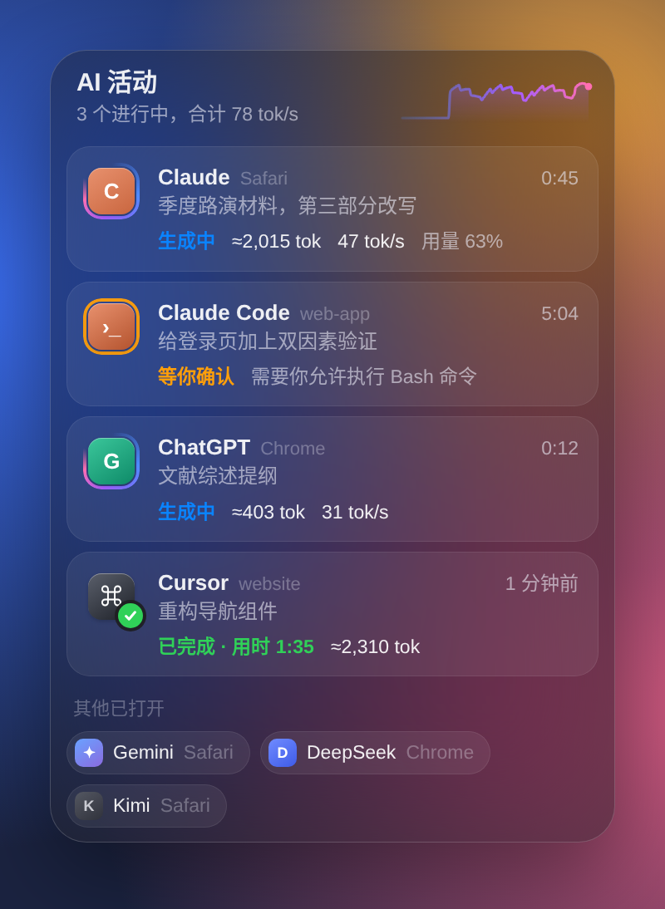
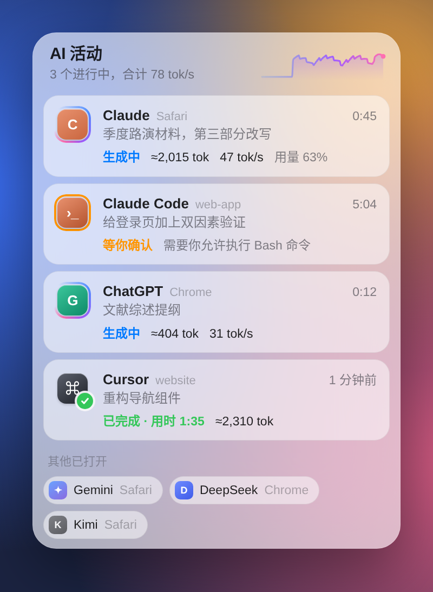
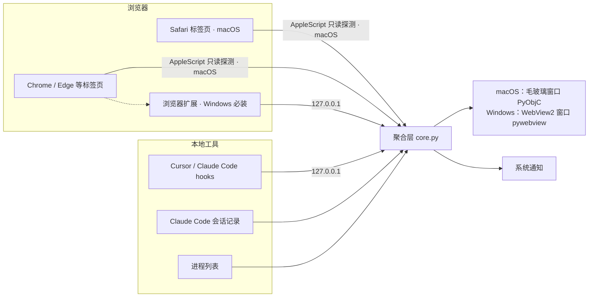

<div align="center">

# ✦ AI 活动

**一个 macOS / Windows 桌面小组件，把你所有 AI 的工作状态汇总到一处。**

浏览器里的 Claude、ChatGPT、Gemini、Kimi、DeepSeek，加上 Cursor 和 Claude Code，<br>
谁在生成、谁在等你确认、谁刚做完，一眼看清。发完消息，就可以去做别的事了。


&nbsp;&nbsp;

[English](#english) · [安装](#安装) · [工作原理](#工作原理) · [常见问题](#常见问题)

</div>

---

## 为什么做这个

同时用好几个 AI 已经是常态：网页里让 Claude 改稿，ChatGPT 查资料，Cursor 在写代码，终端里 Claude Code 在跑任务。问题是它们都需要你**盯着**：切过去看一眼还在生成，切回来，过一会儿再切过去，才发现早就做完了，或者 Agent 卡在等你点“允许”已经五分钟。

**AI 活动** 把这些状态收进桌面角落的一个小窗口，并在任务完成时通知你。你不用再来回切换窗口确认进度。

## 功能

- 🔍 **自动发现**：自动识别浏览器里打开了哪些 AI 网站（macOS：Safari、Chrome、Arc、Edge、Brave；Windows：Chrome、Edge、Brave），无需逐个配置
- ⚡ **实时状态**：生成中 / 等你确认 / 已完成 / 出错 / 已停止，附用时、输出 token 数和生成速度（tok/s）
- 🔔 **完成提醒**：任务结束时发送系统通知并播放提示音，页面刷新等短暂变化不会误报
- 🧑‍💻 **编程 Agent**：Claude Code 显示**真实** token 数、上下文大小、正在执行的工具，需要你授权时立即标橙；Cursor 显示任务进度和标题
- 🖱 **一键跳转**：点击任意条目，直接切到对应的浏览器标签页或应用
- 🍎 **原生质感**：macOS 上是系统毛玻璃材质，Windows 11 上是系统圆角与阴影，都跟随系统深浅色；可以一直浮在最上层
- 🔒 **只在本机**：不连接任何外部服务器，不上传对话内容

### 支持的来源

| 来源 | 识别方式 | 能看到 |
|---|---|---|
| Claude · ChatGPT · Gemini · DeepSeek · Kimi · 豆包 · 通义 / Qwen · 元宝 · Grok · Le Chat · Perplexity | macOS：系统自动化（Safari 与 Chromium 系浏览器）<br>Windows：浏览器扩展（Chrome、Edge、Brave） | 状态、用时、token 估算、速度；点击跳回标签页 |
| 同上，装了浏览器扩展时 | 扩展旁路读取流式响应 | 更精确的 token 数；Claude 用量百分比 |
| Claude Code | 读取本地会话记录 + hooks | 真实 token、上下文、当前工具、待授权 |
| Cursor | hooks（安装时自动配置） | 状态、用时、token 估算、任务标题 |
| Cursor · Claude 桌面版 · ChatGPT 桌面版 | 进程检测（两个系统都支持） | 列入“已打开” |

## 安装

### macOS

需要 **macOS 12 或更新版本**（系统自带的 Python 3.9+ 即可）。

```bash
git clone https://github.com/hfliyc-collab/ai-activity.git
cd ai-activity
./install.sh
```

> 国内网络可使用镜像：`PIP_INDEX_URL=https://pypi.tuna.tsinghua.edu.cn/simple ./install.sh`

安装脚本会：建立独立的 Python 环境并安装 PyObjC；生成 `~/Applications/AI 活动.app`；检测到 Cursor / Claude Code 时自动接入 hooks（原配置先备份）；然后启动。菜单栏会出现 ✦ 图标。

**首次运行：三个权限（各开一次）**

1. **允许控制浏览器**：系统弹窗询问“AI 活动”是否可以控制 Safari / Chrome 时，点“允许”。
2. **Safari**：设置（⌘,）› 高级 › 勾选“显示网页开发者功能”；设置顶部会多出 **开发者** 标签页，在“自动化”里勾选“允许来自 Apple 事件的 JavaScript”。
   <sub>Safari 16 及以前：开发 菜单 › 允许来自 Apple 事件的 JavaScript</sub>
3. **Chrome**：菜单栏 显示 › 开发者 › 勾选“允许来自 Apple 事件的 JavaScript”。Arc、Edge、Brave 位置类似。

缺少某项权限时，小组件仍能识别你打开了哪些 AI，并会在窗口内提示如何开启。想要更精确的 token 数，可以另外安装下文的浏览器扩展（可选）。

### Windows

需要 **Windows 10 或 11**，以及 Chrome、Edge 或 Brave 浏览器。

1. 下载本仓库（右上角 Code › Download ZIP）并解压，或者 `git clone`。
2. 双击根目录的 **`install.bat`**。
   脚本会自动：找到或安装 Python 3.12；安装依赖（pywebview、pystray、Pillow）；检查 WebView2 运行库；接入 Cursor / Claude Code；在开始菜单创建“AI 活动”；然后启动。桌面右上角出现小组件，任务栏右下角托盘区出现 ✦ 图标。
3. **安装浏览器扩展**（Windows 上读取网页状态必须用它）：
   - 在 Chrome 地址栏打开 `chrome://extensions`（Edge 是 `edge://extensions`）
   - 打开“开发者模式”（Edge 叫“开发人员模式”）
   - 点“加载已解压的扩展程序”，选择 `%LOCALAPPDATA%\AIStatus\extension`（安装结束时会自动打开这个文件夹）
   - 刷新已经打开的 AI 网页
4. 接入了 Cursor 的话，重启一次 Cursor。

> 国内网络可先在 PowerShell 里执行 `$env:PIP_INDEX_URL="https://pypi.tuna.tsinghua.edu.cn/simple"`，再运行 `windows\install.ps1`。

托盘图标右键菜单：显示 / 隐藏小组件、始终置顶、完成时提醒、开机自动启动、打开扩展文件夹、退出。

### 浏览器扩展说明

扩展在 Windows 上是必装项，在 macOS 上是可选项。它只在 AI 网站上运行，只把状态数字和网页标题发给本机的小组件（`127.0.0.1`），不读取、不发送对话内容。它还负责“点击条目跳回对应标签页”。

### 卸载

- macOS：`./uninstall.sh`
- Windows：双击 `uninstall.bat`

都会移除程序、开机启动项，以及 Cursor / Claude Code 里本工具的 hooks（其他 hooks 保留）。浏览器扩展需在扩展管理页手动移除。

## 使用

| 操作 | 效果 |
|---|---|
| 拖动顶部标题区 | 移动窗口，位置会被记住 |
| 点击条目或标签 | 跳到对应标签页 / 应用 |
| 菜单栏 ✦（macOS）/ 托盘 ✦（Windows） | 显示进行中的任务数；切换置顶、完成提醒、开机启动等 |

图标外圈彩色光环旋转 = 正在生成；橙色呼吸 = 等你确认；绿色勾 = 完成。完成的任务保留 10 分钟，之后收进“已打开”。

## 工作原理



**网页状态**由两条线索共同判断：页面上是否出现“停止生成”按钮，以及最后一条回复的字数是否仍在增长。即使网站改版导致按钮选择器失效，靠字数增长依然能工作，只是开始和结束的判定会晚一两秒。探测脚本只返回数字，不返回对话内容。

**token 数**：标 `≈` 的为估算（中日韩文字约 1 字 1 token，其他约 4 字符 1 token，误差通常在一到三成），适合看进度和速度；不带 `≈` 的为真实值，来自 Claude Code 本地记录或接口返回的用量字段。

### 项目结构

```
app/
  main.py           macOS：原生窗口、菜单栏、通知（PyObjC）
  core.py           聚合层与状态机、本机 HTTP 接口（两个系统共用，可单独测试）
  browsers.py       浏览器标签页发现与探测（JXA）
  local_sources.py  Claude Code 会话记录解析、进程检测（macOS / Windows）
  sites.py          站点定义：新增网站只改这里
  ui/index.html     界面；直接用浏览器打开会显示演示数据
windows/
  main_win.py       Windows：pywebview 窗口、托盘图标、开机启动
  notify_win.py     Windows 系统通知
  install.ps1       Windows 安装脚本（由 install.bat 调用）
hooks/              Cursor / Claude Code hooks 与一键安装脚本
extension/          浏览器扩展（Windows 必装，macOS 可选）
tools/              由 app/sites.py 生成扩展的站点表
install.sh / install.bat        一键安装（macOS / Windows）
uninstall.sh / uninstall.bat    卸载
```

## 扩展

**新增网站**：在 `app/sites.py` 的 `SITES` 里加一项（域名、“停止”按钮选择器、回复消息选择器），运行 `python tools/gen_extension_sites.py` 同步到浏览器扩展，再重新安装。

**接入任何工具**：能发 HTTP 请求就能接入。

```bash
curl -X POST http://127.0.0.1:47823/event -H "Content-Type: application/json" \
  -d '{"session":"job-1","label":"批处理","state":"working","title":"转换 200 个文件"}'
# 结束时：state 改为 "done"，可附 "tokens_out": 1200, "est": false
```

查看当前汇总数据：`curl http://127.0.0.1:47823/state`

## 隐私

- 只监听 `127.0.0.1`，不发起任何外部网络请求
- 网页探测脚本只读，只返回字数与状态
- 任务标题来自网页标题或你在 Agent 里的提问，只显示在本机窗口
- 修改 Cursor / Claude Code 配置前自动备份，卸载时只移除本工具的条目

## 常见问题

<details><summary><b>窗口一直显示“正在查找打开的 AI…”</b></summary>

确认已允许“AI 活动”控制浏览器：系统设置 › 隐私与安全性 › 自动化（菜单栏图标里有直达入口）。
</details>

<details><summary><b>网页明明在生成，却显示在“已打开”里</b></summary>

通常是“允许来自 Apple 事件的 JavaScript”没开，窗口里会有橙色提示。也可能是网站改版，欢迎提 Issue，或直接更新 <code>app/sites.py</code> 里的选择器。
</details>

<details><summary><b>Cursor 没有显示</b></summary>

安装后需重启一次 Cursor。hooks 只覆盖 Agent / Chat，Tab 补全不计入。
</details>

<details><summary><b>Claude Code 一直显示“生成中”</b></summary>

超过 10 分钟没有任何活动会自动标记为已停止；安装 hooks 后，结束会即时显示。
</details>

<details><summary><b>Windows：双击 install.bat 被系统拦截</b></summary>

从网上下载的压缩包会被标记。右键压缩包 › 属性 › 勾选“解除锁定”后重新解压；或者在弹出的“Windows 已保护你的电脑”里点“更多信息 › 仍要运行”。
</details>

<details><summary><b>Windows：小组件提示“还没装连接扩展”</b></summary>

按“安装 › Windows”第 3 步加载 `%LOCALAPPDATA%\AIStatus\extension`，然后刷新 AI 网页。扩展更新后也需要在扩展管理页点一下“重新加载”。
</details>

<details><summary><b>Windows：窗口一片空白</b></summary>

通常是缺少 WebView2 运行库，从 https://go.microsoft.com/fwlink/p/?LinkId=2124703 安装后重新打开“AI 活动”。
</details>

<details><summary><b>启动后没有反应</b></summary>

运行下面的命令可以看到报错信息，欢迎附在 Issue 里：

```bash
# macOS
~/Library/Application\ Support/AIStatus/venv/bin/python ~/Library/Application\ Support/AIStatus/app/main.py
```

```powershell
# Windows（PowerShell）
& "$env:LOCALAPPDATA\AIStatus\venv\Scripts\python.exe" "$env:LOCALAPPDATA\AIStatus\windows\main_win.py"
```
</details>

## 参与贡献

最需要帮助的是**网站选择器**：各家 AI 网站改版频繁，如果某个网站识别不准，请在 Issue 里写明网站名和现象，或直接提交对 `app/sites.py` 的修改。

本地调试界面：用浏览器打开 `app/ui/index.html` 即可看到演示数据。聚合逻辑 `core.py` 不依赖具体系统，可以在任何系统上写测试。

## 致谢

开发过程中参考了这些开源项目的思路：
[she-llac/claude-counter](https://github.com/she-llac/claude-counter) ·
[lugia19/Claude-Usage-Extension](https://github.com/lugia19/Claude-Usage-Extension) ·
[bozdemir/claude-usage-widget](https://github.com/bozdemir/claude-usage-widget)

本项目与 Anthropic、OpenAI、Google、Anysphere（Cursor）等公司无关，相关名称仅用于说明兼容性。

## License

[MIT](LICENSE)

---

<a name="english"></a>

## English

**AI Activity** is a desktop widget for macOS and Windows that shows, at a glance, what all your AI tools are doing: Claude, ChatGPT, Gemini, Kimi, DeepSeek and more in Safari or Chrome, plus Cursor and Claude Code.

- Auto-detects open AI tabs across Safari, Chrome, Arc, Edge and Brave
- Live states (working / needs you / done), elapsed time, token counts and speed
- Real token and context numbers for Claude Code; Cursor via hooks
- Notifies you when a task finishes; click any item to jump to its tab
- Native vibrancy window, follows light/dark mode, floats or sits on the desktop
- Runs entirely on your Mac; no conversation content is read out or sent anywhere

```bash
git clone https://github.com/hfliyc-collab/ai-activity.git && cd ai-activity && ./install.sh
```

macOS 12+: run `./install.sh`; on first run, allow Automation access to your browsers and enable “Allow JavaScript from Apple Events” in Safari (Settings › Developer) and Chrome (View › Developer).

Windows 10/11: double-click `install.bat`, then load the unpacked extension from `%LOCALAPPDATA%\AIStatus\extension` in `chrome://extensions` or `edge://extensions` (required on Windows, optional on macOS).
